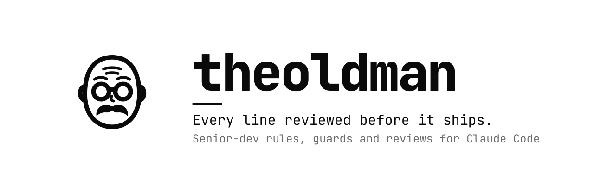

<p align="center">
  <picture>
    <source media="(prefers-color-scheme: dark)" srcset=".github/assets/banner-dark.svg">
    
  </picture>
</p>

# theoldman

Senior-developer rules, guards and reviews for Claude Code.

> Status: in development. Not ready for use yet.

theoldman is a Claude Code plugin. Once installed, every request in Claude Code goes through it:

- **Builder:** Claude writes code that follows senior-dev rules: no filler comments, strict types, tests, docs kept in sync.
- **Guard:** risky actions are blocked before they run: secrets in files, edits to `.env`, force-push to `main`, destructive database commands.
- **Reviewer:** before Claude says "done", the change is reviewed and only confirmed issues are sent back to fix. The same review runs on pull requests in CI.

Nothing leaves your machine. The hook scripts have no dependencies and make no network calls.

## Install

Requires Claude Code 2.1.332 or later and Node 22.13+.

```text
/plugin marketplace add prajwal000/theoldman
/plugin install theoldman@theoldman
/theoldman:init
```

## Development

Requires Node 22.13+ and pnpm.

```text
pnpm install
pnpm check    # lint, typecheck, tests, and a check that plugin/scripts is up to date
pnpm build    # bundles packages/hooks into plugin/scripts
```

The bundles in `plugin/scripts` are committed, because the plugin installs from git with no build step. Run `pnpm build` after changing hook code and commit the result.

## Docs

- [Decisions](docs/adr/)

## License

MIT
